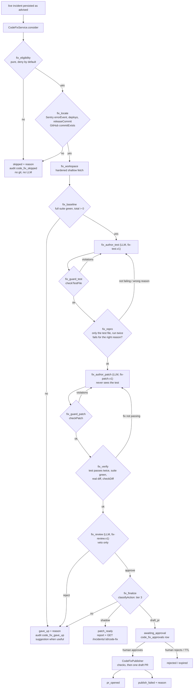

# Code fixer

Since 0.5 (spec [`009-code-fixer`](../specs/009-code-fixer/spec.md), AC-60 to AC-85), the copilot can propose a fix for
a small code bug behind a live incident. When the diagnosis and the error provider's own data point at a small bug in a
repository you allowlisted, it:

1. writes a regression test that reproduces the error and must fail on today's code;
2. writes the smallest patch that makes that test pass without breaking the suite;
3. has the diff reviewed by a third, veto-only prompt;
4. attaches the patch and the evidence to the incident report.

In `draft_pr` mode it then asks a human to approve opening a **draft** pull request on GitHub. **It never merges**, never
approves, labels, comments on or closes a pull request, and opens at most one pull request per error group.

The thesis does not change: **the model proposes; code and humans decide.** The model writes one test file, one small
source edit and one review. Code decides whether the incident is eligible, which repository, file, line and commit,
whether the test fails for the right reason, whether the suite still passes, whether the diff is small, the tier, and
whether anything reaches GitHub. A human decides whether the pull request is opened.

**Most incidents are skipped, and that is the normal outcome.** Every skip and every give-up leaves a typed reason, an
audit row and, when something was learned, a suggestion in the report.

Items marked *(unverified)* are not confirmed by the provider's documentation. The code handles them defensively; see
the last two sections.

## Contents

- [The flow](#the-flow)
- [Eligibility: why most incidents are skipped](#eligibility-why-most-incidents-are-skipped)
- [Reasons](#reasons)
- [Limits](#limits)
- [Denied paths](#denied-paths)
- [Isolation](#isolation)
- [GitHub token setup](#github-token-setup)
- [Shadow mode and draft_pr mode](#shadow-mode-and-draft_pr-mode)
- [Approvals with curl](#approvals-with-curl)
- [Docker](#docker)
- [Facts and sources](#facts-and-sources)
- [Unverified](#unverified)

## The flow

The fixer is a **separate job**, outside the incident graph. When a live incident is persisted as `advised`, the alert
queue's follow-up (after the run slot is released) calls `CodeFixService.consider(incidentId)`, which never throws and
never awaits the attempt. `CodeFixQueue` runs attempts with its own concurrency (`limits.maxConcurrent`). The fixer reads
the incident's blackboard once and never writes it: it holds no run slot and no `runs` row, and the incident's status,
approvals and report are unchanged by it.



Each author has at most `limits.maxAuthorAttempts` calls; any stage can also end in `budget_exhausted` or
`attempt_timeout`. Give-ups are values, never exceptions: nothing in the fixer throws into the queue or changes the
incident. On start, `CodeFixService.recover()` ends `running` attempts as `gave_up/interrupted` (an interrupted attempt
is not resumed) and re-enqueues `publishing` attempts, whose publish is idempotent.

Where it lives:

| Part | Files |
|---|---|
| Contracts | `src/contracts/code-fix.ts` (attempt, view, reasons, proposals) |
| Pure rules | `src/domain/code-fix/` (eligibility, frames, paths, limits, guards, repro, budget, PR body, injection scan) |
| Graph | `src/graph/code-fix/` (state, routes, one node per file, all ids prefixed `fix_`) |
| Service, queue, publisher | `src/app/code-fix-service.ts`, `code-fix-queue.ts`, `code-fix-publisher.ts` |
| Workspace and sandbox | `src/infra/code-fix/` (`GitCliWorkspace`, `ProcessSandboxRunner`, the self-test, the kit) |
| GitHub | `src/codehost/github/` (REST client, URL builders, error kinds) |
| Prompts | `fix-test.v1`, `fix-patch.v1`, `fix-review.v1` in `FIX_PROMPTS` (`src/prompts/v1/`) |

## Eligibility: why most incidents are skipped

`evaluateEligibility()` (`src/domain/code-fix/eligibility.ts`) is pure and deny by default. It checks, in order, and the
first failure is the reason:

1. The incident is `advised` and was not escalated (`not_advised`).
2. It came from a Sentry issue alert: `origin.source` is `sentry` and the fingerprint, set by the Sentry ingest code and
   never by the model, is `issue:<numeric id>` (`source_unsupported`). Metric alerts and every other connector are out.
3. The diagnosis is `bad_deploy` (`category_not_code`) with `medium` or `high` confidence (`low_confidence`). There is
   no `code_bug` category: `bad_deploy` plus the deterministic evidence below is the code-bug signal.
4. The alert's service maps to exactly one allowlisted repository (`service_not_allowlisted`).
5. That repository's connector has `errorEvent`, `releaseCommit` and `deploys` (`connector_unsupported`).
6. The startup sandbox self-test passed (`sandbox_unavailable`).
7. The repository's daily cap is not reached (`daily_cap_reached`).
8. No attempt holds the key of the error group `(repo, errorGroupId)` (`already_attempted`).

Then `fix_locate` maps the error to a file **from connector data only**:

- the latest event's raised exception must be one of `fixableExceptionTypes` (default `TypeError`, `RangeError`,
  `ReferenceError`);
- the error group must be **new in the failing release**: the event's `release` has a deploy at or before the alert's
  start (plus 5 minutes), and the issue's `firstSeen` is no earlier than 5 minutes before that deploy. A missing
  `firstSeen` or release fails closed (`not_new_in_release`);
- the innermost in-app frame, after stripping `pathPrefixes`, must be a safe repo-relative path (no `..`, no absolute
  or Windows path, no `node_modules/`, `dist/`, `build/` or `.min.` segment) with a `.js`, `.mjs`, `.cjs`, `.ts`,
  `.mts` or `.cts` extension, inside `sourceGlobs` and outside every denied path;
- the commit is the release's `lastCommit.id` when it is 40 hex and its repository is the allowlisted `owner/name`,
  else the release version (or its part after the last `@`) when that is 40 hex. GitHub must confirm it exists.

Every check above happens before any git command or LLM call, so a skip costs a few REST reads at most. A skipped row
never holds the key, so it never blocks a later attempt.

## Reasons

Every attempt that does not succeed has exactly one reason (`CodeFixReasonSchema`).

**Skipped** (no git, no LLM, no code-host write; never holds the key):

| Reason | Meaning |
|---|---|
| `not_advised` | the incident is not `advised`, or it was escalated |
| `source_unsupported` | not a Sentry issue alert |
| `category_not_code` | the diagnosis is not `bad_deploy` |
| `low_confidence` | the diagnosis confidence is `low` |
| `service_not_allowlisted` | no repository in `codeFix.repositories` for the alert's service |
| `connector_unsupported` | the connector lacks `errorEvent`, `releaseCommit` or `deploys` |
| `sandbox_unavailable` | the startup self-test failed; the fixer is disabled |
| `daily_cap_reached` | `limits.maxAttemptsPerDay` attempts of this repository entered `running` in the last 24 hours |
| `already_attempted` | an attempt holds the error group's key, or `limits.maxAttemptsPerGroup` attempts exist for it |
| `error_event_unavailable` | Sentry returned no readable latest event for the issue |
| `exception_not_fixable` | the raised exception is not in `fixableExceptionTypes` |
| `not_new_in_release` | the error group is not new in a deploy of the failing release, or the data is missing |
| `no_in_app_frame` | the stack trace has no in-app frame |
| `path_not_allowlisted` | the anchor frame is unsafe or outside `sourceGlobs` |
| `path_denied` | the anchor frame is a denied path |
| `commit_unresolved` | no 40-hex commit from the release's last commit or its version |
| `commit_not_found` | GitHub does not know that commit in the allowlisted repository |

**Gave up** (after the workspace exists). A reason marked *transient* releases the key, so a later alert of the same
group may try again while fewer than `maxAttemptsPerGroup` attempts exist:

| Reason | Meaning |
|---|---|
| `workspace_failed` *(transient)* | the git fetch or checkout failed |
| `file_changed_since_release` | the anchor file is missing at the release commit or differs at the base head |
| `line_out_of_range` | the anchor line is past the end of the file |
| `file_not_regular` | the anchor is a symlink or a submodule at the base head |
| `baseline_not_green` | the suite does not pass with at least one test before any change |
| `baseline_timeout` *(transient)* | the baseline suite timed out |
| `sandbox_error` *(transient)* | the runner could not start or its report contradicted the exit code |
| `author_unavailable` *(transient)* | a test or patch author call failed or returned invalid output |
| `budget_exhausted` | `maxLlmCalls` or `maxTokens` would be exceeded |
| `attempt_timeout` *(transient)* | the whole attempt ran longer than `attemptTimeoutMin` |
| `guard_rejected` | the test or patch guard rejected every allowed proposal; the codes are in `violations` |
| `repro_not_failing` | the new test passes on the buggy code |
| `repro_wrong_reason` | the new test fails, but not with the incident's error in the anchor file |
| `repro_flaky` | the two runs of the new test disagree |
| `edit_not_applicable` | a `search` text does not occur exactly once |
| `fix_not_passing` | the new test still fails after the patch |
| `fix_flaky` | the two runs of the new test after the patch disagree |
| `suite_regressed` | the suite after the patch has a failure |
| `test_count_dropped` | the suite after the patch does not have the baseline count plus the new tests, or more skipped or todo |
| `unexpected_file` | the work tree changed a path other than the new test and the edited sources |
| `patch_too_large` | a changed file's post-image is over 256 KiB, or the patch is over 20,000 characters |
| `patch_contains_secret` | redaction would change the patch |
| `reviewer_rejected` | the reviewer returned `reject` |
| `reviewer_unavailable` *(transient)* | the reviewer call failed or returned invalid output |
| `catalog_refused` | `classifyAction` did not give exactly tier 3 with valid parameters |
| `interrupted` *(transient)* | the process restarted during the attempt |

**Publish failed** (`draft_pr` only, after approval):

| Reason | Meaning |
|---|---|
| `patch_mismatch` | the stored patch or a post-image does not hash to the approved `patchSha256` |
| `base_unprotected` | `GET /branches/{baseBranch}` does not report `protected: true` |
| `stale_base` | a patched file changed on the base branch since the base commit; nothing is rebased |
| `ref_conflict` | the fix branch exists and points at something that is not our commit |
| `codehost_error` *(transient)* | GitHub failed (auth, rate limit, timeout, unavailable, bad response). While publishing, a timeout, rate limit, unavailable or bad response is retried up to 3 times (honouring `Retry-After`). If retries run out after the commit was saved, the attempt stays `publishing` and keeps the error group's key, so the next try finds the existing branch or pull request instead of opening a second one; with no commit saved yet, the attempt ends `publish_failed` and the key is released |

Statuses: `skipped`, `running`, `gave_up`, `patch_ready`, `awaiting_approval`, `approved`, `rejected`, `expired`,
`publishing`, `pr_opened`, `publish_failed`. Stages: `eligibility`, `locate`, `workspace`, `baseline`, `author_test`,
`guard_test`, `repro`, `author_patch`, `guard_patch`, `verify`, `review`, `finalize`, `publish`.

## Limits

"Small" is enforced by code. The ceilings live in `src/domain/code-fix/limits.ts`; `codeFix.limits` can only lower them,
and the loader refuses a value above a ceiling.

| Limit | Default | Allowed | What it bounds |
|---|---|---|---|
| `maxConcurrent` | 1 | 1 to 2 | attempts running at once (separate from `MAX_CONCURRENT_RUNS`) |
| `maxFiles` | 3 | 1 to 3 | files changed, the test included |
| `maxSourceLines` | 20 | 1 to 20 | added plus removed lines in source files |
| `maxTotalLines` | 50 | 1 to 50 | added plus removed lines, the test included |
| `maxTestLines` | 40 | 1 to 40 | lines of the new test file |
| `maxEdits` | 2 | 1 to 2 | search-and-replace edits in one patch proposal |
| `maxAuthorAttempts` | 2 | 1 to 3 | calls per author (test author and patch author each) |
| `maxLlmCalls` | 6 | 3 to 8 | LLM calls per attempt |
| `maxTokens` | 60,000 | 1,000 to 200,000 | prompt plus completion tokens per attempt |
| `attemptTimeoutMin` | 15 | 1 to 30 | the whole attempt |
| `testTimeoutSec` | 120 | 5 to 600 | one test run; the whole process group is killed |
| `maxOutputBytes` | 65,536 | 4,096 to 262,144 | stdout and stderr per run (tail kept) |
| `maxAttemptsPerDay` | 5 | 1 to 20 | attempts per repository in 24 hours |
| `maxAttemptsPerGroup` | 3 | 1 to 5 | attempts per error group, ever |

Other fixed rules: one new test file, never an edit to an existing test; no new import, `require` or dynamic import in
the patch; at least one hunk within 20 lines of the anchor line; every edited file among the event's in-app frames;
`codeFix.approvalTtlHours` from 1 to 168 (default 72).

The guards (`test-guard.ts`, `patch-guard.ts`, `checkDiff`) are pure, report every violation at once and are a
heuristic floor. Isolation and human approval are the real controls.

## Denied paths

The fixer never anchors on or edits a path that matches `BUILT_IN_DENIED` (`src/domain/code-fix/paths.ts`). Matching
ignores case, a pattern without `/` matches a name at any depth, and a pattern that matches a directory denies everything
below it:

```text
.github/**  .gitlab-ci.yml  .circleci/**  **/migrations/**  **/migrate/**  **/*.sql  infra/**  terraform/**  **/*.tf
deploy/**  k8s/**  helm/**  **/Dockerfile*  **/docker-compose*  **/auth/**  **/security/**  **/crypto/**  **/session*
**/permission*  **/payment*  **/billing/**  **/secret*  **/.env*  **/*.pem  **/*.key  **/.*rc*  **/*.config.*
package.json  package-lock.json  npm-shrinkwrap.json  yarn.lock  pnpm-lock.yaml  bun.lockb  tsconfig*.json  .npmrc
.nvmrc  AGENTS.md  CONTRIBUTING.md  CODEOWNERS  **/vendor/**  **/node_modules/**  dist/**  build/**
```

A repository's `deniedPaths` only adds to this list; there is no negation. Add anything a model should never touch
without a person who owns it, such as pricing rules or feature flags.

## Isolation

The model writes code that then runs on your host. Read this section before you enable the fixer.

### The workspace

`GitCliWorkspace` creates `mkdtemp(<TMPDIR>/ic-fix-)` with four siblings: `repo/` (the work tree), `tmp/` (the child's
`HOME` and `TMPDIR`), `kit/` (the sandbox preload and reporter) and `git/` (the askpass script). It runs `git init`,
`git fetch --depth 1 --no-tags origin <baseBranch> <sha>` and `git checkout --detach`, every command through
`execFile` (no shell), with the host's global and system git config ignored and hooks, symlinks, fsmonitor, credential
helpers, submodules and LFS disabled; only `https` is allowed as a protocol. The token reaches git only through
`GIT_ASKPASS`, a 0700 script that prints an environment variable set only on fetch children: never in a URL, argv or
`.git/config`. The directory is removed when the attempt ends, whatever the outcome.

There is **no dependency install**: `npm ci`, `npx` and lifecycle scripts are arbitrary code with network access. The
fixer only supports repositories whose suite runs with plain `node --test` and no install or build step (Node's type
stripping covers TypeScript).

### The permission model

`ProcessSandboxRunner` builds the whole command line itself; config only names test globs (`testFiles`), which pass a
strict character allowlist:

```text
[unshare --user --map-root-user --net --]        # isolated mode only
<node> --permission
  --allow-fs-read=<attempt>/repo --allow-fs-read=<attempt>/kit --allow-fs-read=<attempt>/tmp
  --allow-fs-write=<attempt>/tmp
  --disallow-code-generation-from-strings
  --import=<attempt>/kit/preload.ts
  --test --test-isolation=none
  --test-reporter=<attempt>/kit/reporter.ts --test-reporter-destination=stdout
  <test files or globs>
```

- No `--allow-child-process`, `--allow-worker`, `--allow-addons`, `--allow-wasi` or `--allow-inspector`. The copilot's
  source, `copilot.yaml`, `.env` and database are outside every read grant, and nothing can be written outside `tmp/`.
- The child starts with no shell, as the leader of its own process group; a timeout or abort sends `SIGKILL` to the
  whole group. Output is capped at `maxOutputBytes` and redacted.
- The environment is an allowlist, never inherited: `PATH`, `HOME`, `TMPDIR`, `CI=1`, `NODE_ENV=test`, `LANG=C.UTF-8`,
  `TZ=UTC`, `NO_COLOR=1`. `GITHUB_FIX_TOKEN`, `OPENROUTER_API_KEY`, `APPROVAL_TOKEN` and `API_TOKEN` are never in it.
- The preload replaces `fetch`, blocks `node:net`, `tls`, `dgram`, `dns`, `http`, `https`, `http2` and `child_process`
  through `module.registerHooks`, and locks `process.getBuiltinModule`. That is best effort: Node 24.21 has no
  `--allow-net`, so the preload is **not** the network control.

### The network: `unshare`

`codeFix.sandbox.network: isolated` (the default) wraps the command in `unshare --user --map-root-user --net`
(util-linux, Linux only): the child gets a new user namespace and an empty network namespace with only a down loopback
interface, so no TCP connection leaves it.

### The self-test

When `codeFix` is enabled, the service runs a bundled probe through the full runner once at start. It must prove:

| Check | Phase |
|---|---|
| a planted environment secret and the copilot's own secret variables are absent | with the preload |
| `child_process` is denied | with the preload, then without it (the permission model alone) |
| a write outside `tmp/` is denied | with the preload |
| reads of `copilot.yaml`, `.env`, `data/`, `COPILOT_CONFIG` and the database file are denied | with the preload |
| the preload blocks `fetch` and `node:net` | with the preload |
| TCP to `127.0.0.1` and to `api.github.com` fails | without the preload, `isolated` only |

If any check fails in `isolated` mode, the fixer is disabled: the log has `code_fix_sandbox_unavailable` with the failed
check ids, and every eligible incident is recorded `skipped/sandbox_unavailable`. It fails closed; it never falls back
to `best_effort` on its own.

### `best_effort`

`codeFix.sandbox.network: best_effort` runs without `unshare`: the permission model, the environment allowlist and the
preload still apply, but a test could open a socket by a path the preload does not cover. Choose it explicitly, only on
a host you are willing to expose to code a model wrote, for example a disposable VM or a developer machine with no
secrets. It is stamped on every attempt (`isolation: "best_effort"`), on the report's "Code fix" section and on the pull
request body, and the self-test does not claim the network checks.

### The in-process report caveat

Results come from our reporter (NDJSON lines on stdout) and are cross-checked with the exit code: an empty report, zero
tests, a non-zero exit with no failure or a zero exit with a failure are all `error`, never `passed`. But the reporter
runs **in the same process** as the tests (`--test-isolation=none`), so code that runs there could forge results. That
is why model-written code is statically banned from touching `process`, `console`, `globalThis`, `global`, `self`,
`getBuiltinModule`, `Reflect`, `Proxy`, `eval`, `Function`, `require` and dynamic import (one list shared by the test and
patch guards; any `\u` or `\x` escape, a non-ASCII character in code and a computed key built from strings are rejected
too, since identifiers can be spelled with escapes), and why a human reviews the diff before any pull request exists. A
pull request is evidence, not proof.

### Docker and Linux hosts

- **Docker's default seccomp profile** blocks the `unshare` and `clone` namespace flags for a process without
  `CAP_SYS_ADMIN`, so inside a stock container the `isolated` self-test fails and the fixer stays disabled *(unverified:
  depends on the Docker version and profile)*. Options, safest first: run the copilot on a host or VM where unprivileged
  user namespaces work; run the container with a seccomp profile that allows `unshare` and `clone` with
  `CLONE_NEWUSER | CLONE_NEWNET` (never `--privileged` and never `seccomp=unconfined`); or choose `best_effort`
  knowingly.
- **User namespaces inside a container** also need the host to allow them (`user.max_user_namespaces` above 0, and on
  some distributions `kernel.unprivileged_userns_clone=1`) *(unverified)*.
- **Ubuntu 24.04 restricts unprivileged user namespaces with AppArmor**
  (`kernel.apparmor_restrict_unprivileged_userns=1`): `unshare` may create the namespace but cannot map the user, so the
  self-test fails and the fixer **fails closed** *(unverified on 24.04 point releases)*. Allowing it means an AppArmor
  profile for `/usr/bin/unshare` or lowering that sysctl, both host-wide decisions for the host's owner.
- **macOS** has no `unshare`: only `best_effort` can pass the self-test there. That is fine for development with the
  scripted fake; do not use it for real alerts.

## GitHub token setup

The fixer uses one **fine-grained personal access token**, referenced as `${GITHUB_FIX_TOKEN}` (a whole `${VAR}`
secret, joined to the redaction list):

1. In GitHub, create a fine-grained personal access token (Settings, Developer settings, Personal access tokens,
   Fine-grained tokens; *unverified*: menu labels change).
2. **Repository access:** only select repositories, exactly the ones in `codeFix.repositories`.
3. **Permissions:** `Contents: Read and write` and `Pull requests: Read and write`. Nothing else (no workflows, no
   administration, no secrets).
4. Set an expiry and put the value in the environment: `GITHUB_FIX_TOKEN=...` in `.env`.
5. **Protect `baseBranch`** on each repository (a branch protection rule or a ruleset that requires a pull request and a
   review). In `draft_pr` mode the publisher refuses with `base_unprotected` unless `GET /branches/{baseBranch}` reports
   `protected: true`. Branch protection is what keeps a token with `contents: write` from pushing to `main`; the
   copilot only writes `incident-copilot/fix-<attemptId>` branches by construction, but the token itself could.

The copilot cannot introspect a fine-grained token's scopes, so steps 2, 3 and 5 are **operator duties**. The client
also refuses, before any request, an owner or repository outside the allowlist. In shadow mode the token is optional for
public repositories: the only GitHub request is a `GET` of the release commit, plus the git fetch. GitHub App
installation tokens and separate read and write tokens are 0.6 items.

## Shadow mode and draft_pr mode

| | `shadow` (default) | `draft_pr` |
|---|---|---|
| Successful attempt ends | `patch_ready` | `awaiting_approval`, with an approval row bound to `patchSha256` and an `approval_requested` audit at tier 3 |
| GitHub requests | `GET` of the commit (and the git fetch) | after approval: branch, compare, pull lookup, blobs, tree, commit, ref, pull request |
| Needs | nothing extra | `APPROVAL_TOKEN`, `codeFix.github.token`, branch protection on `baseBranch` |
| Where to read it | `GET /incidents/:id/code-fix` and the postmortem's "Code fix" section | the same, plus `GET /approvals` and the draft pull request |

**Start in shadow mode** and read a few patches before you let it ask for pull requests. `config check` and `npm start`
refuse `draft_pr` without `APPROVAL_TOKEN` or without a token.

The catalog action is `open_draft_pull_request`: tier 3, not a mitigation, not reversible, reserved for the
`code_fixer` proposer. The planner never sees it, and a planner or MCP client that proposes it gets tier 4
(`blocked_forbidden`, MCP refusal `action_reserved`).

After approval, `CodeFixPublisher` (the only holder of a GitHub writer; the fixer graph only has a reader):

1. re-hashes the stored patch and post-images and compares them with the approved `patchSha256` (`patch_mismatch`);
2. classifies the action again: exactly tier 3 with valid parameters (`catalog_refused`);
3. requires `protected: true` on the base branch (`base_unprotected`);
4. requires no patched file to have changed on the base branch since the base commit (`stale_base`);
5. returns an existing pull request for `incident-copilot/fix-<attemptId>` if there is one;
6. creates blobs, a tree on the base commit's tree and one commit with `parents: [baseCommitSha]` and a fixed author and
   date (`codeFix.commitAuthor`, the time the patch was ready), so a retry builds the same commit SHA; then the ref;
7. opens the pull request with `draft: true` and `maintainer_can_modify: false`.

The pull request body carries the incident link, the exception, the location, the release and base commits, the
isolation mode, the evidence counts, the new test names and the file table. It never carries test output text, and the
commit message and body carry no co-author or attribution lines. Notifiers that list `code_fix_ready` or
`code_fix_pr_opened` in their `events` get a message; the default `events` stay the four 0.4 kinds.

## Approvals with curl

Code-fix approvals live in their own table (`code_fix_approvals`), so they never count in an incident's pending
approvals, expiry or status, but they share the approval routes. With the API on `localhost:3000`, `API_TOKEN` and
`APPROVAL_TOKEN` in the environment:

```bash
# The attempt of an incident: status, reason, files, patch and evidence (never the post-images).
curl -s localhost:3000/incidents/INC-0001/code-fix -H "Authorization: Bearer $API_TOKEN" \
  | jq '{status, stage, reason, isolation, patchSha256, files}'

# Pending approvals of both kinds; a code-fix one has subject "code_fix" and the attempt id in actionId.
curl -s 'localhost:3000/approvals?status=pending' -H "Authorization: Bearer $API_TOKEN" \
  | jq -c '.[] | select(.subject == "code_fix") | {id, actionId, patchSha256, expiresAt}'

# Read the patch before deciding.
curl -s localhost:3000/incidents/INC-0001/code-fix -H "Authorization: Bearer $API_TOKEN" | jq -r .patch

# Approve (or "reject"); the same token, lockout and decision text rules as action approvals.
curl -s -X POST localhost:3000/approvals/APR-0002/decision \
  -H 'content-type: application/json' \
  -H "Authorization: Bearer $API_TOKEN" \
  -H "X-Approval-Token: $APPROVAL_TOKEN" \
  -d '{"decision":"approve","approver":"ana","comment":"read the diff and the test"}'
```

The decision answers 200 with `{ approval, incident }`, and the incident is unchanged. An approval queues the publish;
read the outcome again with `GET /incidents/:id/code-fix` (`pr_opened` with `pullRequest.url`, or `publish_failed` with
its reason). A second decision answers 409 `approval_not_pending`; 409 `code_fix_not_awaiting_approval` means the
approval is still pending but its attempt no longer awaits it. An overdue approval answers 409 and the
attempt ends `expired`; it is accepted while the incident is `advised` or `resolved`, because the bug outlives the
incident. A rejected or permanently failed group is not retried.

## Docker

The image installs `git` (the workspace), `util-linux` (`unshare`) and `ca-certificates` (git verifies https with the
system bundle) with `apt-get install --no-install-recommends`, and sets `TMPDIR=/data/code-fix`, a scratch directory
owned by `node`, outside `/app`. A new named volume gets that directory from the image. A volume created by 0.4 does
not; create it once before enabling the fixer:

```bash
docker compose run --rm --entrypoint sh copilot -c 'mkdir -p /data/code-fix'
```

Without it the startup self-test fails, the fixer stays off (log event `code_fix_sandbox_unavailable`) and every
eligible incident is recorded as `skipped` / `sandbox_unavailable`; no attempt starts. See [Docker and Linux
hosts](#docker-and-linux-hosts) for `unshare` inside a container.

## Facts and sources

Checked for 0.5.0. Sentry facts are also listed in [`docs/connectors/sentry.md`](connectors/sentry.md#code-fixer);
Node 24.21 permission-model and test-runner facts are in [`docs/api-notes.md`](api-notes.md).

From https://docs.sentry.io/api/ (events and issues, releases):

- Retrieve an issue: `GET /api/0/organizations/{organization}/issues/{issue_id}/`, with `firstSeen`, `lastSeen` and
  `project`.
- An issue's latest event: `GET /api/0/organizations/{organization}/issues/{issue_id}/events/latest/`, with `entries[]`
  (an entry of `type: "exception"` whose `data.values[]` has `type`, `value` and `stacktrace.frames[]`) and `tags[]` as
  `{ key, value }`, including `release`.
- Stack frames carry a file name, an absolute path, line and column numbers, the function name and an in-app flag,
  innermost last (the field casing is unverified, see below).
- Retrieve a release: `GET /api/0/organizations/{organization}/releases/{version}/`, with `lastCommit` and `projects`.

From https://docs.github.com/en/rest (Git database, branches, commits, pulls):

- Requests send `Accept: application/vnd.github+json`, `Authorization: Bearer <token>` and the
  `X-GitHub-Api-Version` header.
- Git database: `POST /repos/{owner}/{repo}/git/blobs`, `POST .../git/trees` (with `base_tree`), `POST .../git/commits`
  (with `parents`, `author` and `committer` dates), `POST .../git/refs`, `GET .../git/ref/heads/{branch}` and
  `GET .../git/commits/{sha}`.
- `GET /repos/{owner}/{repo}/branches/{branch}` returns `name`, `commit.sha` and `protected`.
- `GET /repos/{owner}/{repo}/compare/{base}...{head}` returns `files[]`.
- `GET /repos/{owner}/{repo}/pulls?head={owner}:{branch}&state=all` and `POST /repos/{owner}/{repo}/pulls` with `draft`
  and `maintainer_can_modify`.
- Fine-grained personal access tokens are scoped to selected repositories, with per-permission read or write access
  (`Contents`, `Pull requests`).

The `tiny-cart` repository in `tests/fixtures/repos/` and the Sentry payloads in `tests/fixtures/` are built from these
descriptions, not captured from a real account.

## Unverified

Handled defensively, not relied upon:

- **Sentry endpoints and fields for the fixer.** The issue detail, latest event and release detail paths above and the
  field names are read from the documentation, not from a live account. The mapper reads only the exception's `type`,
  `value` and frames (`filename`, `abs_path`, `lineno`, `colno`, `function`, `in_app`), the `release` tag, `firstSeen`
  and `lastCommit` (`id`, `repository.name`). It never reads `vars`, `context_line`, `pre_context`, `post_context`,
  `request`, `user`, `contexts` or `breadcrumbs`. It also accepts a top-level `exception.values` when there is no
  `entries[]`. A 404 is "no data" (a skip), anything unreadable is `bad_response`.
- **The snake_case versus camelCase frame field names** in the latest event response (`lineno` or `lineNo`, `in_app`
  or `inApp`, `abs_path` or `absPath`): the mapper reads only `filename`, `abs_path`, `lineno`, `colno` and `in_app`.
  If your Sentry answers with camelCase only, every attempt skips with `no_in_app_frame` instead of guessing; check one
  attempt in shadow mode before relying on it.
- **Whether `lastCommit.repository.name` is `owner/name`** as configured in Sentry's repository integration. When it is
  not, the commit falls back to a 40-hex release version, or the attempt skips with `commit_unresolved`.
- **The GitHub API version header.** The client sends `X-GitHub-Api-Version: 2022-11-28`; whether a newer version
  changes any field the client reads was not checked.
- **Branch `protected` visibility.** Whether `GET /branches/{branch}` reports `protected: true` for a branch protected
  only by a repository ruleset, and whether a fine-grained token without administration permission sees it. When it
  does not, the publisher refuses with `base_unprotected`: it fails closed, never open.
- **Branch names with `/`** in `/branches/{branch}`, `/compare/{base}...{head}` and `/git/ref/heads/{branch}`: the
  client keeps the slashes literal and encodes each segment.
- **The compare file cap.** `compare` is read as listing at most 300 files; a response that long may be truncated, so
  it fails closed as a `bad_response` (`publish_failed/codehost_error`).
- **A 422 on `POST /git/refs` for an existing ref.** The publisher looks the ref up again and accepts it only when it
  points at our commit, or at a commit with our tree and parents `[baseCommitSha]`; anything else is `ref_conflict`.
- **`unshare` in containers and on Ubuntu 24.04**, as described in [Docker and Linux hosts](#docker-and-linux-hosts):
  the self-test is what decides on your host, and it fails closed.
- **The GitHub settings menu path** in [GitHub token setup](#github-token-setup).
