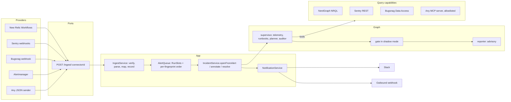
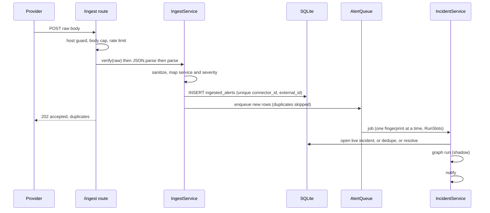

# Connectors architecture

How incident-copilot plugs into an observability and error stack (spec `specs/008-connectors/spec.md`, release 0.4.0). The thesis is unchanged: **the model proposes; code and humans decide.** Live incidents run in shadow mode: the team investigates and plans, the gate classifies, nothing executes.

## Overview



## Layers and files

| Path | Contents | May import |
|---|---|---|
| `src/contracts/ingest.ts`, `src/contracts/live-telemetry.ts` | Zod schemas: `NormalizedAlert`, `IncidentOrigin`, ingest records, normalized telemetry records | zod only |
| `src/domain/ingest/*` | Pure: service mapping, severity mapping, text sanitizing, token bucket, dedupe decision | contracts |
| `src/connectors/types.ts` | Connector port | contracts, domain, infra types |
| `src/connectors/shared/*` | HTTP client over injected `fetch`, webhook auth helpers, config helpers, conformance kit types | node, infra |
| `src/connectors/<type>/` | One folder per provider: `index.ts` (definition), `config.ts`, `ingest.ts`, `query.ts` | shared, contracts, domain |
| `src/connectors/index.ts` | `CONNECTOR_DEFINITIONS`, the only list of registered types | every connector |
| `src/notifiers/*` | Same pattern for notifiers (`types.ts`, `index.ts`, `<type>/`): `slack`, `outbound-webhook` | shared, contracts |
| `src/infra/copilot-config/*` | `copilot.yaml` loader: read, YAML or JSON parse, zod schema built from the definitions | node, yaml |
| `src/app/*` | `IngestService`, `AlertQueue`, `RunSlots`, `NotificationService`, `IncidentContextResolver`, live parts of `IncidentService` | everything below |
| `src/http/routes/ingest.ts`, `connectors.ts` | Ports | app |

The graph never imports a connector. It receives an `IncidentContextResolver` and the tool registry through its factories.

## Connector port

```ts
export interface ConnectorDefinition<C> {
  readonly type: string;                              // "sentry"; also the docs file name
  readonly displayName: string;
  readonly capabilities: readonly ("ingest" | "query")[];
  configSchema(h: ConfigHelpers): z.ZodType<C>;       // the connector entry without id, type, enabled and severityMap
  create(config: C & BaseEntryFields, deps: ConnectorDeps): ConnectorInstance;   // no I/O in create
}
export type BaseEntryFields = { readonly severityMap: Readonly<Record<string, Severity>> | null }; // added by the registry
export type ConnectorDeps = { id: string; http: HttpClient; fetch: typeof fetch; now: () => Date; logger: Logger };
export interface ConnectorInstance {
  readonly id: string;
  readonly type: string;
  readonly ingest: IngestCapability | null;
  readonly query: QueryCapability | null;
  close?(): Promise<void>;
}
```

### Ingest capability

```ts
export type InboundRequest = {
  connectorId: string; requestId: string; receivedAt: Date;
  headers: Readonly<Record<string, string>>;  // lower-case names, first value
  rawBody: Buffer;                            // exact bytes, for HMAC
  pathToken: string | null;                   // /ingest/:id/:token
  remoteAddress: string;
};
export interface IngestCapability {
  verify(req: InboundRequest): VerifyOutcome;                 // sync, constant time, never throws
  parse(body: unknown, req: InboundRequest): ParseOutcome;    // sync, pure, never throws
}
export type VerifyOutcome = { ok: true } | { ok: false; reason: "missing_credentials" | "invalid_credentials" | "invalid_signature" | "ip_not_allowed" };
export type ParseOutcome =
  | { kind: "alerts"; alerts: NormalizedAlert[] }   // one payload may carry many (Alertmanager groups)
  | { kind: "ignored"; reason: string }             // a valid event that is not an alert (Sentry installation, Bugsnag comment)
  | { kind: "invalid"; issues: string[] };          // never echoes values
```

`verify` runs before `JSON.parse`, on the raw bytes. Helpers in `src/connectors/shared/auth.ts` implement the schemes once: `bearer`, `basic`, `header` (custom name and value), `path_token`, `hmac` (algorithm, header, encoding, optional prefix) and an optional IP allowlist.

### Query capability

```ts
export type QueryWindow = { from: Date; to: Date };
export type QueryIO = { signal: AbortSignal; now: Date };
export interface QueryCapability {
  readonly metricNames?: readonly string[];
  metrics?(q: { service: string; metric: string; window: QueryWindow }, io: QueryIO): Promise<MetricSeries | null>;
  logs?(q: { service: string; level: "ERROR" | "WARN"; window: QueryWindow; limit: number }, io: QueryIO): Promise<LogEntry[]>;
  deploys?(q: { service: string; since: Date }, io: QueryIO): Promise<DeployRecord[]>;
  errors?(q: { service: string; window: QueryWindow; limit: number }, io: QueryIO): Promise<ErrorGroup[]>;
  external?: { tools(io: QueryIO): Promise<ExternalToolInfo[]>; call(tool: string, args: Record<string, unknown>, io: QueryIO): Promise<ExternalResult> };
}
```

A method throws only `ConnectorError { kind: "auth" | "rate_limited" | "timeout" | "unavailable" | "bad_response" | "unsafe_input"; retryAfterSec: number | null }`. The registry catches it and writes an `ok: false` observation.

Normalized records (`src/contracts/live-telemetry.ts`; all text fields clipped, nullable when the vendor lacks them):

| Record | Fields |
|---|---|
| `ErrorGroup` | `id, title, culprit, level, status, count, userCount, firstSeen, lastSeen, release, url` |
| `MetricSeries` | `metric, unit, points: { ts, value }[]` (at most 500) |
| `LogEntry` | `ts, level, message, count` |
| `DeployRecord` | `version, at, environment, author, description, url` |
| `ExternalToolInfo` | `name, description, inputSchema` (JSON, clipped) |
| `ExternalResult` | `ok, text` |

## NormalizedAlert and the ingest pipeline

The fields are in the spec. Each connector decides `externalId` (stable across retries of the same provider event) and `fingerprint` (stable across events of the same problem):

| Connector | `externalId` | `fingerprint` | `resolved` when |
|---|---|---|---|
| alertmanager | `<fingerprint>:<startsAt>:<status>` | alert `fingerprint` (else hash of sorted labels) | `status: resolved` |
| newrelic | `<issueId>:<state>:<updatedAt or createdAt>` | `issue:<issueId>` | `state: CLOSED` |
| sentry | per resource: `event_alert:<event_id>:<rule>`, `metric_alert:<id>:<action>:<date>`, `issue:<id>:<action>:<lastSeen>` | `issue:<issue id>` or `metric_alert:<id>` | issue `resolved`, metric alert `resolved` |
| bugsnag | `<trigger.type>:<error.id>:<receivedAt>`; `errorStateManualChange` adds the `stateChange` segment | `error:<errorId>` or `spike:<project.id>` | `errorStateManualChange` with `stateChange: fixed` |
| webhook | mapped path | mapped path, default `externalId` | mapped status in `resolvedValues` |



Job handling (`IncidentService`, in one store transaction each):

- **firing, no open live incident**: `openFromAlert` creates the incident (`scenarioId = live:<connectorId>`, `timeOffsetSec = 0`, empty world, `origin`), audits `incident_opened` and `alert_ingested`, inserts `live_incidents`, notifies `incident_opened`, runs the graph, notifies `analysis_ready` or `run_failed`.
- **firing, open live incident younger than `dedupeWindowMin`**: audit `alert_ingested` with `deduplicated: true`; no run.
- **resolved, open live incident**: audit `alert_resolved`, close `live_incidents`, set status `resolved` and `resolvedAt` to the alert time, notify `incident_resolved`.
- **resolved, none open**: outcome `ignored`.

Every outcome is written back to the `ingested_alerts` row.

## Queue

`AlertQueue` (`src/app/alert-queue.ts`) is in process:

- **Slots.** `RunSlots` is shared with `POST /incidents`, which used to keep a private counter. At most `MAX_CONCURRENT_RUNS` graph runs at a time.
- **Ordering.** Jobs with the same `connectorId + fingerprint` run in arrival order, so a resolve never overtakes the run that opened the incident.
- **Bound.** `ingest.maxQueued` (default 100) is back-pressure: while the queue is at that size the route answers 503 before recording anything, so the provider's retry is not lost. A request is never split or refused for being larger than the room left (an Alertmanager group can carry hundreds of alerts); its rows are the durable queue, and `recoverQueued` re-enqueues them after a restart. The rate-limit token is taken only after the credentials verify, so unauthenticated requests cannot starve the real provider.
- **Recovery.** `recoverQueued()` on start re-enqueues rows still `queued`.
- **Shutdown.** `drain(timeoutMs)` runs on SIGTERM.
- **Failures.** A thrown job, including `UnscriptedLlmCallError`, becomes outcome `failed` with a short redacted detail. The worker keeps going.

## Tool registry and incident context

```ts
export type IncidentContext =
  | { kind: "scenario"; scenario: LoadedScenario }
  | { kind: "live"; sources: LiveSource[]; services: ServiceMap; incidentService: string | null; origin: IncidentOrigin };
export type LiveSource = { connectorId: string; type: string; query: QueryCapability };
export interface IncidentContextResolver { resolve(state: Pick<Blackboard, "scenarioId" | "timeOffsetSec" | "origin">): IncidentContext }

export type ToolContext = { incident: IncidentContext; world: WorldState; now: Date; signal?: AbortSignal };
export interface ToolRegistry {
  names(ctx: ToolContext): Promise<ReadToolName[]>;
  describeForPrompt(ctx: ToolContext): Promise<string>;
  run(name: string, args: unknown, ctx: ToolContext): Promise<ToolResult>;   // never throws
}
```

- **Scenario context.** The registry uses the 4 existing tools, unchanged except `run` becoming async. `describeForPrompt` is compared with a frozen copy in a test.
- **Live context.** The registry lists a tool only when some source has the capability:

  | Tool | Capability | Parameters |
  |---|---|---|
  | `query_errors` | `errors` | `service, window, limit <= 5` |
  | `query_metrics` | `metrics` | `service, metric` (one of the sources' `metricNames`), `window` |
  | `query_logs` | `logs` | `service, level, window, limit <= 5` |
  | `list_deploys` | `deploys` | `service, sinceMinutes` |
  | `query_external` | `external` | `source, tool, arguments` (at most 2,000 characters as JSON). The MCP connector accepts only the `service` and `window` keys the operator's `arguments` template uses, each against an allowlist; `service` also goes through the scope check and the alias mapping |

- **Results.** Every source with the capability is called in sequence, each with its own timeout. Each answer is validated by zod and formatted by one pure formatter (`src/tools/live/format.ts`), one section per connector. The evidence references follow the same pattern for every vendor, for example `errors:<connectorId>:<service>@HH:MM-HH:MM`.
- **Service names.** A tool's `service` must be the incident's service or a configured canonical service. It is translated to each connector's alias.
- **Evidence sources.** `SOURCE_BY_TOOL` maps `query_errors` to `errors` and `query_external` to `external`.

Nodes that read the context:

| Node | Scenario | Live |
|---|---|---|
| telemetry | tools over the scenario | live tools |
| auditor | scenario deploys and inventory | inventory `null`; deploys from the `deploys` capability for the alert's service, failures become `[]` |
| reporter | scenario series and `expectedCategory` | no series, category from the diagnosis, `advisory` template report, no LLM call |
| executor, verifier | as today | throw a defect error: shadow mode never routes there |

## Shadow mode in the gate

The mode comes from the blackboard (`origin.mode`), not from global config, so every run of an incident behaves the same.

- **Same as today:** tier 4 and unknown types are blocked, invalid parameters are rejected, and steps that depend on them are cancelled. Same events, same critique.
- **Accepted step:** status `recommended`, `dryRun: null`, no approval. Audit `action_recommended`, which keeps the tier.
- **Observation text:** "recommended (shadow mode, not executed)", plus "would require human approval" at tier 3.
- **Hand-off:** `gate → reporter`. `afterGate` returns `reporter` for shadow and the graph gains that edge. The reporter writes the `advisory` report.
- **Status:** `deriveIncidentStatus` returns `advised` for an `advisory` report without escalation.

Roadmap: a `supervised` mode where tier 2 runs and tier 3 asks for approval, through real executors registered beside `SimulatedInfra`. Tier 4 stays without an executor.

## Notifiers

```ts
export interface NotifierDefinition<C> { readonly type: string; configSchema(h: ConfigHelpers): z.ZodType<C>; create(config: C, deps: { id: string; http: HttpClient; logger: Logger }): Notifier }
export interface Notifier { readonly id: string; readonly type: string; send(m: NotificationMessage, io: { signal: AbortSignal }): Promise<NotifyOutcome> }
export type NotificationKind =
  | "incident_opened" | "analysis_ready" | "run_failed" | "incident_resolved"   // DEFAULT_NOTIFICATION_EVENTS
  | "code_fix_ready" | "code_fix_pr_opened";                                    // opt-in (spec 009, AC-83)
export type NotificationMessage = {
  kind: NotificationKind; incidentId: string; title: string; service: string | null; severity: Severity; status: IncidentStatus;
  source: { connectorId: string; type: string; url: string | null };
  diagnosis: { category: string; confidence: string; hypothesis: string } | null;
  recommendations: { order: number; actionType: string; target: string; tier: 1 | 2 | 3 | 4; status: string }[];
  links: { incident: string | null };   // from publicUrl
  sentAt: string;
  codeFix?: CodeFixNotification;         // only on code_fix_*: counts, names and booleans, never patch or output text
};
export type NotifyOutcome = { ok: true } | { ok: false; retryable: boolean; retryAfterSec: number | null; reason: string };
```

- **Building.** `NotificationService` builds the message with a pure function, runs `redactSecrets` over it, and sends to the notifiers subscribed to the kind (`events`, default all).
- **Retries and timeout.** One retry on a retryable outcome, waiting `Retry-After` up to 10 s. A 5 s timeout per send.
- **Failures.** Logged only. A failed send never changes the incident.

## Configuration

`COPILOT_CONFIG` points to `copilot.yaml` (empty means no connectors: scenario mode only).

```yaml
version: 1
mode: shadow                      # the only accepted value in 0.4
publicUrl: https://copilot.example.com
ingest: { maxBodyBytes: 1048576, rateLimitPerMin: 60, maxQueued: 100, dedupeWindowMin: 1440, trustProxy: false }
services:
  - name: checkout-api
    aliases: { prom: [checkout], sentry-prod: [checkout-web], newrelic: ["Checkout API (prod)"] }
connectors:
  - id: prom
    type: alertmanager
    ingest: { auth: { type: bearer, token: "${ALERTMANAGER_WEBHOOK_TOKEN}" } }
  - id: sentry-prod
    type: sentry
    ingest: { clientSecret: "${SENTRY_CLIENT_SECRET}" }
    query: { baseUrl: https://sentry.io, organization: my-org, token: "${SENTRY_AUTH_TOKEN}" }
notifiers:
  - id: incidents-channel
    type: slack
    webhookUrl: "${SLACK_WEBHOOK_URL}"
    events: [analysis_ready, incident_resolved]
```

How the loader works:

- **Parsing.** YAML via `yaml@2.8.1` or JSON. Then a zod schema built from the registered definitions: a base entry `{ id, type, enabled?, severityMap? }`, then `definition.configSchema(helpers)` for that type.
- **Interpolation.** `helpers.text()` interpolates `${VAR}` in non-secret strings.
- **Secrets.** `helpers.secret()` accepts only a whole `${VAR}` naming a set variable of at least 16 characters (`secret({ min })` to change it), and adds the value to the redaction list.
- **URLs.** `helpers.url()` requires https, except for loopback hosts.
- **Errors.** Each problem is `{ path, rule }`, never a value and never zod's own text.
- **Cross-checks.** Connector ids are unique, aliases reference existing connectors, and every ingest block declares authentication.

`assertLiveSafe` in `src/index.ts` refuses ingest connectors with the fake provider.

## Security

- **Authentication.** `/ingest/*` skips `API_TOKEN`; each connector authenticates with its own scheme. The host guard still applies: a public hostname goes in `ALLOWED_HOSTS`.
- **Comparisons.** Constant-time: HMAC hex digests via `timingSafeEqual` on equal-length buffers, tokens via `constantTimeEqualsText`.
- **Limits.** Route-level `bodyLimit` and a per-connector token bucket on the injected clock.
- **Untrusted text.** Inbound text is sanitized (`src/domain/ingest/sanitize.ts`: control characters removed, `<<<` and `>>>` neutralized, clipped). Tool results arrive as untrusted observations.
- **Query languages.** NRQL and other queries come from config templates. Substituted values must match `^[A-Za-z0-9 ._:/()\[\]-]{1,120}$`, or the tool answers `unsafe_input`.
- **MCP.**
  - Explicit allowlist. A tool annotated `destructiveHint: true` or `readOnlyHint: false` is refused.
  - Text content only, clipped.
  - Operator-written descriptions replace the server's when given.
- **Redaction.** Secrets from config join `collectSecrets`. Outbound requests never log headers or bodies.

## Tests

- **Offline.** Connectors take `HttpClient` built on an injected `fetch`; tests pass `tests/helpers/fake-fetch.ts`. The MCP connector is tested against an in-memory SDK server, through the `createMcpConnector(config, deps, { transportFactory })` test seam.
- **Fixtures.** Representative payloads live in `tests/fixtures/connectors/<type>/`. Each is built from the provider documentation and says so in a sibling `README.md`.
- **Conformance kit.** `tests/helpers/connector-conformance.ts` runs the same invariants for every connector:
  - verify rejects missing and wrong credentials;
  - parse never throws on garbage;
  - output validates against `NormalizedAlertSchema`;
  - no secret appears in outputs;
  - query errors become `ConnectorError`.
- **Live end to end.** `tests/e2e/live-incident.e2e.test.ts` uses Alertmanager ingest, a test-only query connector and the scripted fake. The script `tests/fixtures/llm/live-prom.json` has `scenarioId: "live:prom"`.
- **Scenario mode.** The existing goldens, recordings and audit sequences are the regression net and must not change.
